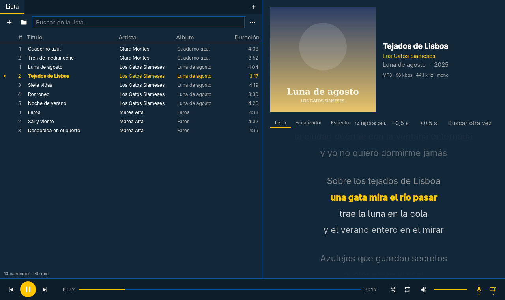
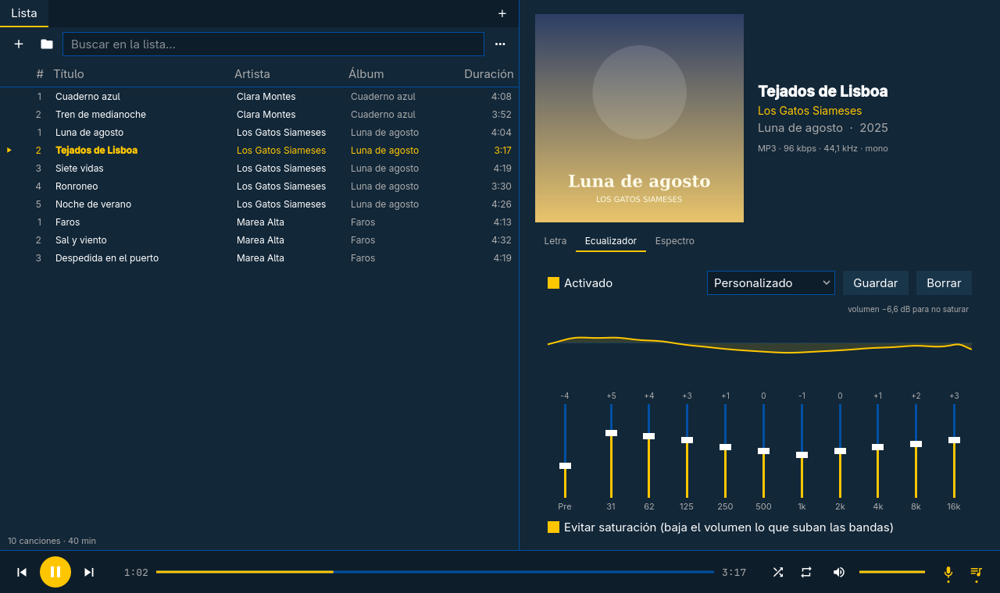
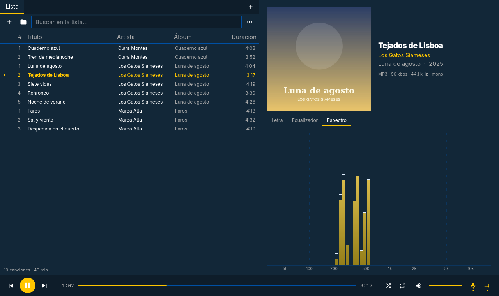
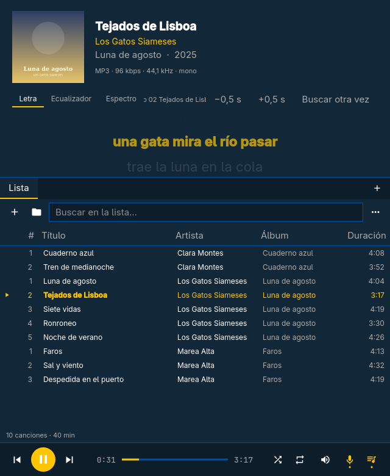

# Sonata

Reproductor de música local para Linux, escrito en C++ con Qt 6, FFmpeg y PipeWire.
Pensado para gastar poca CPU y batería en equipos modestos, y para verse bien
junto al escritorio [Omarchy](https://omarchy.org), cuyos colores sigue.




| Ecualizador | Espectro |
|---|---|
|  |  |



*A media pantalla, la reproducción se pone encima de la lista. Las canciones, carátulas y
letras de las capturas son inventadas, y el tema es Cobalt2 de Omarchy.*

## Qué hace

- Reproduce cualquier formato de audio que entienda FFmpeg (MP3, FLAC, Opus, Ogg,
  AAC/M4A, WAV, APE, WavPack, WMA…), sin cortes entre pistas con la misma frecuencia
  de muestreo y sin remuestrear: el audio va tal cual a PipeWire.
- **Letras**: busca un `.lrc` junto al archivo, la letra incrustada en las etiquetas
  o la descarga de [lrclib.net](https://lrclib.net). Las sincronizadas resaltan la
  línea que suena y se puede pulsar una línea para saltar a ella; ±0,5 s para
  ajustar el desfase.
- **Editar etiquetas** (título, artista, álbum, artista del álbum, género, año,
  pista y disco) para corregir canciones mal etiquetadas: clic derecho en la lista
  o en el título de lo que suena, o Ctrl + I. Se guardan en el propio archivo con
  TagLib; con varias canciones seleccionadas solo cambian los campos que edites.
  Al corregir la canción que suena, la letra se vuelve a buscar con los datos
  nuevos. Si el archivo no se puede escribir, la corrección puede quedarse solo en
  Sonata.
- **Ecualizador** de 10 bandas con preajustes, los tuyos propios y ajuste
  automático de volumen para no saturar.
- **Espectro** en tiempo real: una curva continua de 20 Hz hasta la frecuencia de
  Nyquist de la canción (la mitad de su frecuencia de muestreo).
- **Listas** en pestañas: arrastrar y soltar, búsqueda, ordenar, quitar duplicados,
  importar y exportar M3U.
- Se adapta al tamaño de la ventana: lista y reproducción lado a lado, una encima de
  otra a media pantalla, y compacta en un cuarto de pantalla.
- Controlable desde el escritorio por **MPRIS** (teclas multimedia, `playerctl`,
  barras de estado).
- Una sola instancia: abrir canciones desde el explorador de archivos las añade a la
  ventana que ya está abierta.
- Colores del tema de Omarchy (`~/.local/state/omarchy/current/theme/colors.toml`),
  que cambian al momento al cambiar de tema; sin Omarchy usa un tema oscuro propio.
- Interfaz en español.

## Instalar desde el zip

El zip de cada [versión](https://github.com/julssvanderhaack/sonata/releases) trae
el ejecutable ya compilado para x86-64. Está enlazado con las bibliotecas del
sistema, así que necesitas versiones al menos tan recientes como aquellas con las
que se compiló: **Qt 6.12, FFmpeg 9, TagLib 2 y PipeWire 1.x**. En la práctica, una
distribución basada en Arch al día (Arch, Omarchy, EndeavourOS, CachyOS…):

```sh
sudo pacman -S --needed qt6-base ffmpeg taglib pipewire
unzip sonata-1.0.0-linux-x86_64.zip
cd sonata-1.0.0-linux-x86_64
./install.sh            # en ~/.local (sin sudo)
# sudo ./install.sh --system   # para todos los usuarios, en /usr/local
```

`./install.sh --uninstall` (o `sudo ./install.sh --system --uninstall`) lo quita.

Para que sea el reproductor por defecto de tus archivos de música:

```sh
xdg-mime default sonata.desktop audio/mpeg audio/flac audio/ogg audio/x-vorbis+ogg audio/opus audio/mp4 audio/x-m4a audio/wav audio/x-wav
```

En otras distribuciones, o si el ejecutable se queja de alguna biblioteca, compílalo.

## Compilar

Necesitas un compilador con C++20, CMake ≥ 3.20, Qt 6 (Widgets, Network, DBus,
Concurrent), FFmpeg (libavformat, libavcodec, libavutil, libswresample), TagLib ≥ 2
y PipeWire.

```sh
# Arch:   sudo pacman -S --needed base-devel cmake qt6-base ffmpeg taglib pipewire
# Debian/Ubuntu: sudo apt install build-essential cmake qt6-base-dev libavformat-dev \
#                libavcodec-dev libavutil-dev libswresample-dev libtag-dev libpipewire-0.3-dev
cmake -S . -B build -DCMAKE_BUILD_TYPE=Release
cmake --build build -j"$(nproc)"
cmake --install build --prefix ~/.local
```

Por defecto se optimiza para el procesador de la máquina que compila
(`-march=native`); `-DSONATA_NATIVE=OFF` genera un ejecutable para cualquier x86-64.

## Atajos de teclado

| Tecla | Acción |
|---|---|
| Espacio | Reproducir / pausa |
| ← / → | −5 s / +5 s (con Mayús: 30 s) |
| Ctrl + ← / → | Canción anterior / siguiente |
| Ctrl + ↑ / ↓ | Volumen |
| Ctrl + O / Ctrl + Mayús + O | Añadir archivos / carpeta |
| Ctrl + F | Buscar en la lista |
| Ctrl + T / Ctrl + W | Nueva lista / cerrar lista |
| Ctrl + L / E / G | Letra / ecualizador / espectro |
| Ctrl + K | Mostrar u ocultar letra, ecualizador y espectro |
| Ctrl + I | Editar etiquetas (de las seleccionadas o de la que suena) |

## Dónde guarda las cosas

- Listas: `~/.local/share/sonata/playlists/`
- Estado (volumen, ecualizador, posición): `~/.local/state/sonata/state.json`
- Letras y carátulas descargadas: `~/.cache/sonata/`
- Correcciones de etiquetas guardadas solo en Sonata: `~/.local/share/sonata/tags.json`

## Licencia

[GPL-3.0](LICENSE).
